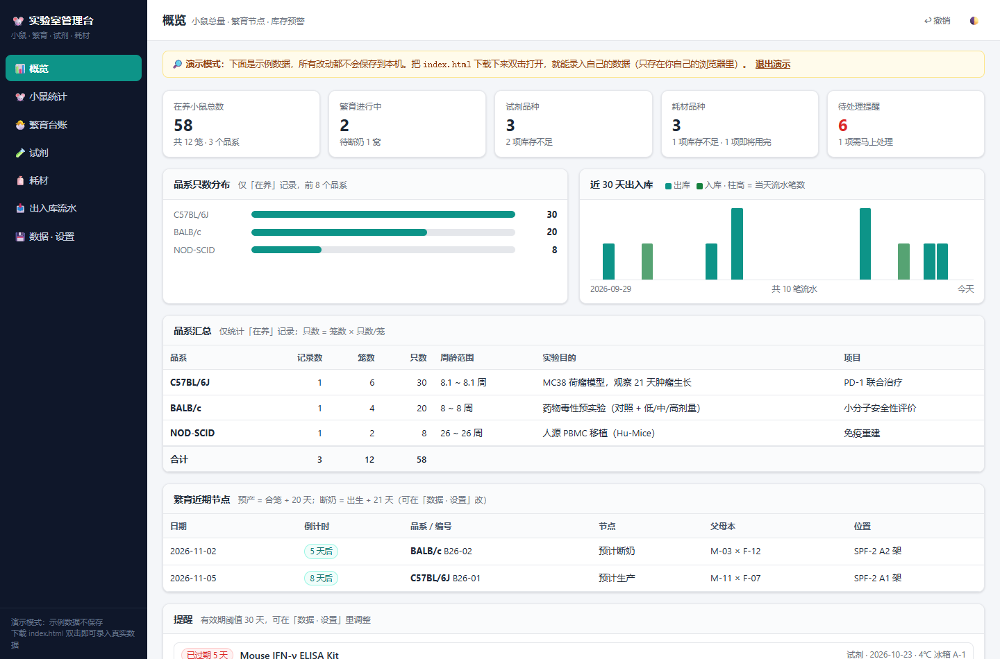
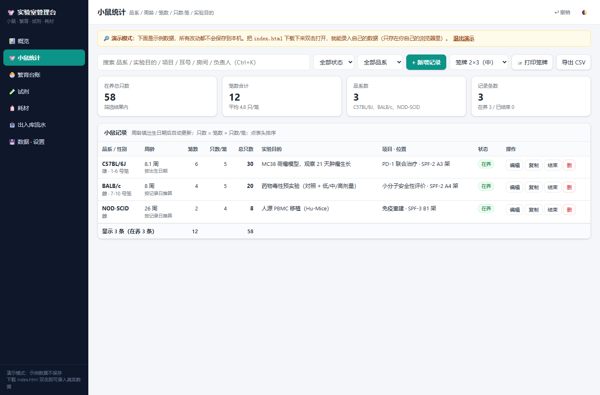
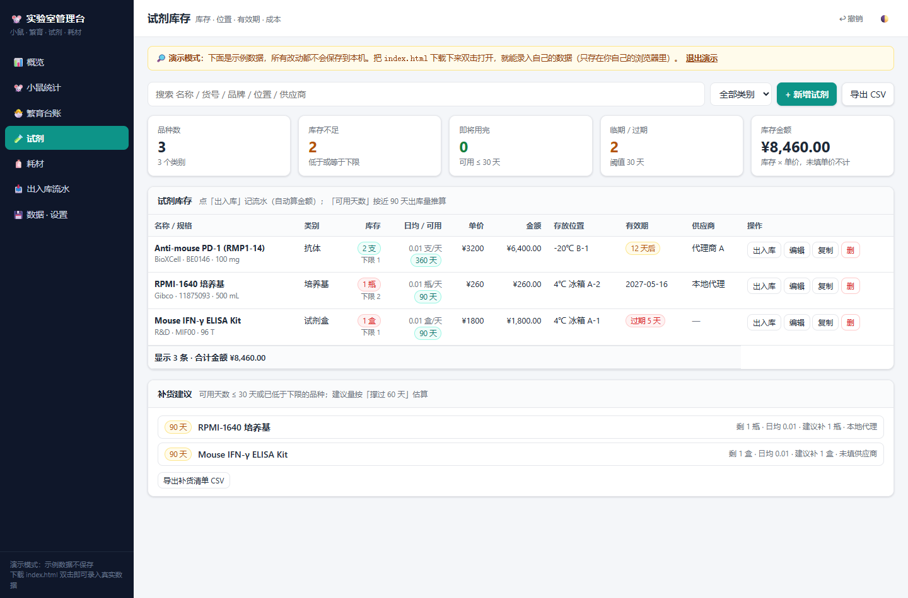
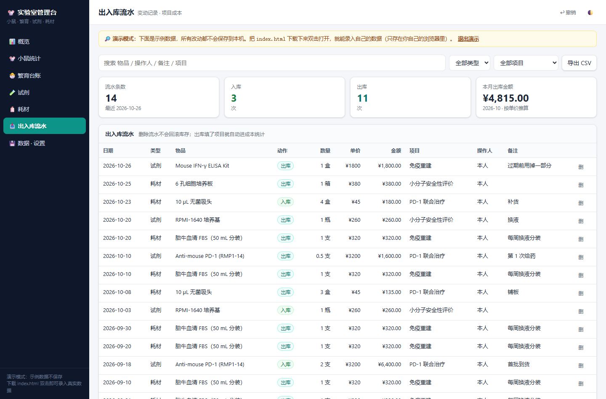
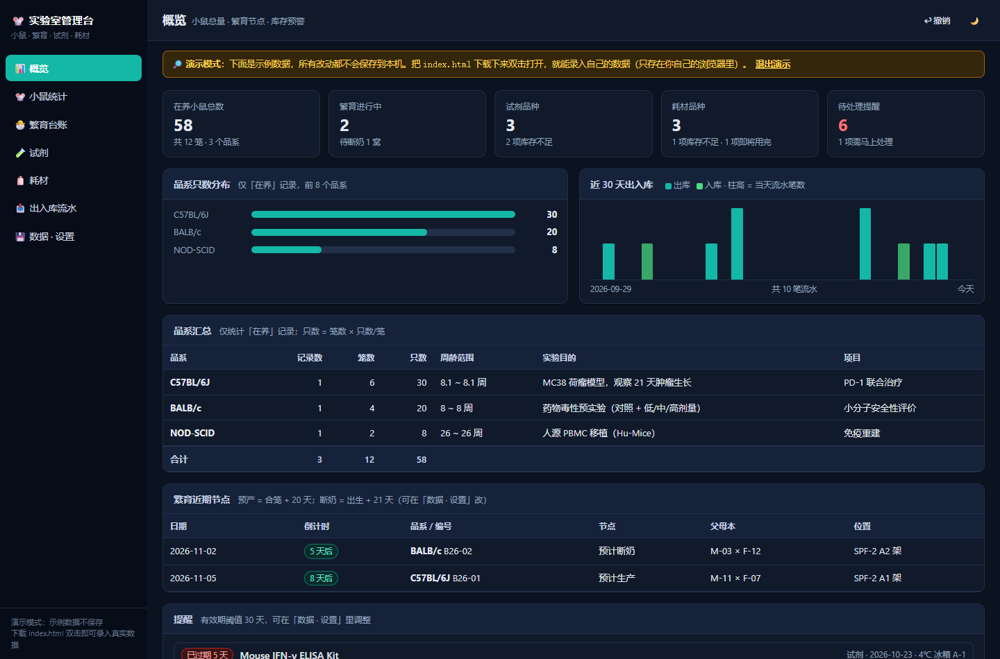
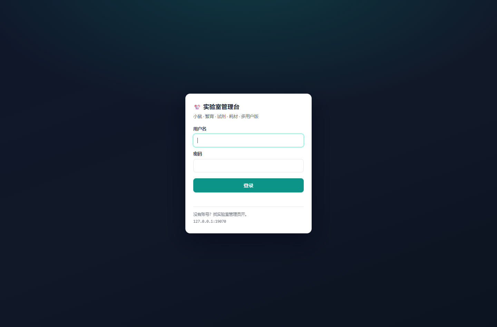
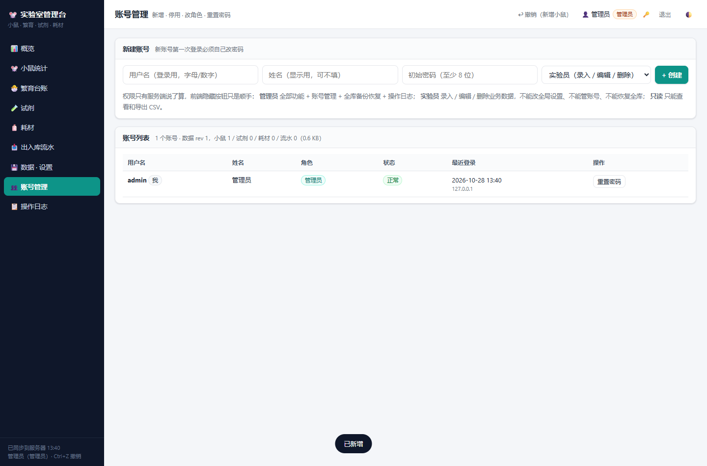

# 🐭 实验室管理台（Lab Mgmt）

**小鼠 · 繁育 · 试剂 · 耗材 · 出入库 · 成本 —— 一个 HTML 文件搞定的实验室台账**

零安装、零依赖、不联网、不上传。把这个 `index.html` 拷到任何电脑，双击用 Edge / Chrome 打开就能用，数据存在本机浏览器里。

v3 起自带**可选的多用户版**：一个实验室共用一份台账，每人一个账号，管理员能开账号、查谁改了什么（仍然零依赖，只要 Node.js）。

[](LICENSE)
[](index.html)
[](package.json)
[](docs/DEPLOY.md)
[](https://github.com/Yu-Qiao-sjtu/lab-mgmt/actions/workflows/ci.yml)

> 在线试用（示例数据，不保存）：<https://yu-qiao-sjtu.github.io/lab-mgmt/?demo=1>



## 为什么做这个

湿实验的日常台账散在 Excel 里：小鼠周龄靠手算、试剂过期靠想起来、耗材用完才发现没存货、笼牌手写。
这个工具把它们收进一个文件里：打开就能录，关上自动存，随时能打印和导出，还能整包备份搬走。
没有服务器、没有账号、没有安装包——不会因为实验室断网、IT 不给装软件、或者换台电脑就没法干活。

## 功能

| 模块 | 内容 |
|---|---|
| 🐭 **小鼠统计** | 品系、性别、周龄（填出生日期自动算并实时增长）、**笼数**、**只数/笼**、自动算总只数、**实验目的**、项目、耳号/笼号、房间架位、负责人、在养 / 已结束 |
| 🐣 **繁育台账** | 配对编号、合笼 / 孕检 / 出生 / 断奶日期、窝仔数、分笼笼数×只数；按「合笼 + 妊娠天数」「出生 + 断奶天数」自动算预产 / 断奶倒计时，一键「转小鼠记录」 |
| 🧪 **试剂** | 名称、货号、品牌、规格、类别、库存、单位、库存下限、单价、位置、开封日期、有效期、供应商 |
| 🧴 **耗材** | 名称、规格、库存、单位、安全库存、单价、位置、供应商 |
| 📥 **出入库流水** | 每次入库 / 出库留痕（日期、数量、单价、金额、项目、操作人、备注），自动加减库存；**超量出库会被拦住**；可按项目统计成本 |
| 📈 **消耗预测** | 按近 N 天出库量算「日均消耗 / 可用天数 / 预计用完日期」，自动生成**补货建议清单**（含建议补货量），可导出 CSV 去询价 |
| 🔔 **提醒** | 试剂已过期 / 临期 / 低于下限、耗材低于安全库存、库存即将用完、繁育超预产期 / 该断奶了 |
| 🖨 **笼牌打印** | 当前筛选结果一键打 A4 笼牌（4 / 6 / 9 张一页三档版式），品系、周龄、笼数、只数、实验目的、负责人、日期 |
| 📊 **概览图示** | 品系只数分布、近 30 天出入库趋势、繁育近期节点、最近流水 |
| 💾 **数据安全** | 每次改动自动保存 + 每天一份自动快照（可回滚到某天）、Ctrl+Z 撤销、JSON 全量备份 / 恢复、CSV 导出（UTF-8 BOM，Excel / WPS 不乱码）、从 Excel / CSV 粘贴导入（表头自动识别、自动去重） |
| 🌓 **深色模式** | 浅色 / 深色 / 跟随系统，点右上角切换，选择跟着备份一起走 |

计算规则：**总只数 = 笼数 × 只数/笼**；周龄按「今天」实时换算；日均消耗 = 统计窗口内出库量 ÷ 窗口天数。

<table>
<tr>
<td></td>
<td></td>
</tr>
<tr>
<td></td>
<td></td>
</tr>
</table>

## 快速开始

**方式一：本地文件（推荐，数据完全在你自己机器上）**

1. 下载 [`index.html`](https://github.com/Yu-Qiao-sjtu/lab-mgmt/releases/latest/download/index.html)（或本仓库里的 `index.html`）；
2. 双击，用 Edge / Chrome 打开；
3. 首次进入点「载入示例数据」看一眼，然后「清空全部数据」开始录自己的；也可以直接从 Excel 粘贴导入。

**方式二：建个桌面快捷方式** —— 右键 `index.html` → 发送到 → 桌面快捷方式。

**方式三：在线用** —— 打开 <https://yu-qiao-sjtu.github.io/lab-mgmt/>。注意：在线版的数据存在**那个网址**的浏览器存储里，和本地文件不互通，只用来看效果或临时用。

**方式四：多人共用（一个实验室一份台账）** —— 在实验室一台常开的电脑上跑自带的小服务器，同事用自己的账号登录：

```bash
node server/index.js          # 或在 Windows 上双击 start.bat
```

窗口里会打印局域网地址和初始管理员密码，浏览器打开登录即可，账号 / 权限 / 日志都在管理员手里。细节见 **[docs/DEPLOY.md](docs/DEPLOY.md)**（含固定 IP、防火墙、开机自启、Tailscale / Cloudflare Tunnel 外网访问、备份恢复、忘记密码）。

> 还是同一个 `index.html`：双击打开是离线单文件版，从服务器地址打开就是多用户版。两边的数据互相独立。

常用键盘操作：`Ctrl+Z` 撤销上一步、`Ctrl+K` 跳到搜索框、`Ctrl+Enter` 保存弹窗表单、`Esc` 关闭弹窗。

## 数据在哪、怎么带走

- 数据存在**当前浏览器**的 `localStorage`，键名 `labmgmt.v1`（老版本键名不变，永远能直接打开）。
- 换电脑 / 换浏览器 / 清浏览器缓存 / 无痕窗口 → 数据**不会**跟过去。所以每个星期到「💾 数据 · 设置 → 下载 JSON 备份」存一份到网盘。
- 换机器：把 `index.html` 和新备份一起拷过去 → 打开 → 「从 JSON 恢复」。
- 多人共用：**不要**把同一个文件放共享盘各自打开（会变成互不同步的多份数据）。请用多用户版：一台电脑跑 `node server/index.js`，大家用浏览器登录同一份数据，谁改的、什么时候改的都记在操作日志里（见 [docs/DEPLOY.md](docs/DEPLOY.md)）。
- 手机 / 平板可以打开，但和电脑不互通，靠 JSON 备份搬运；用多用户版则手机连同一 WiFi 直接登录即可。

## 多用户版（可选）

同一个 `index.html`，多了一层「谁在用」：

| | 单文件版（双击打开） | 多用户版（`node server/index.js`） |
|---|---|---|
| 谁用 | 一个人 | 一个实验室，每人一个账号 |
| 数据在哪 | 你自己浏览器 | 服务器 `data/db.json` |
| 要装什么 | 什么都不用装 | 一台常开电脑 + Node.js 18+ |
| 权限 | 没有 | 管理员 / 实验员 / 只读，**服务端强制校验** |
| 谁改的 | 不知道 | 操作日志：时间 / 账号 / IP / rev / 改了哪几条 |
| 两人同时改 | — | 逐条记录合并，改不同记录互不影响；同一条以后保存的为准 |

- **账号**：密码 `scrypt` + 每用户随机盐；新账号首次登录必须改密码（没改之前连数据都读不到）；同 IP 连续错 6 次锁 5 分钟；至少保留一个管理员。
- **同步**：只发变更的那几条记录（按 id 合并），6 秒内自动看到别人的改动；断网时改动留在页面上，联网后自动重发，不会静默丢。
- **备份**：服务器每天自动留一份 `data/backups/db-YYYYMMDD.json`，保留 30 天；停服务拷走 `data/` 就是完整迁移。
- **外网**：Tailscale（不暴露公网，推荐）或 Cloudflare Tunnel（有域名时顺手），都不用改路由器。

<table>
<tr>
<td></td>
<td></td>
</tr>
</table>

三步跑起来（详细步骤、防火墙、开机自启、忘记密码、迁移：[docs/DEPLOY.md](docs/DEPLOY.md)）：

```bash
node server/index.js            # Windows 上也可以直接双击 start.bat
```

1. 窗口里打印局域网地址和管理员初始密码（只显示一次）；
2. 浏览器打开 → 登录 → 右上角 🔑 改密码；
3. 到「👥 账号管理」给同事开账号，告诉他们初始密码，他们首次登录自己改。

## 仓库结构

```
index.html          ← 构建产物：单文件应用（可直接分发 / 直接用）
src/head.html       ← <head> + 全部 CSS
src/body.html       ← DOM 骨架
src/s1.js … s6.js   ← 应用逻辑（工具/数据层 → 计算 → 视图 → 表单 → 打印 → 导入导出/启动）
src/remote.js       ← 多用户模式：登录、增量同步、账号管理、操作日志
server/             ← 可选的局域网服务器（零依赖：只用 node 内置模块）
  index.js          ←   HTTP 入口、静态页、启动信息
  api.js            ←   接口与权限校验
  auth.js           ←   账号 / scrypt 密码 / 会话 / 登录限速
  store.js          ←   数据落盘（原子写）、每日备份、变更日志、审计
build.js            ← 把 src/ 拼成 index.html，并做语法 / 标签 / 离线自检
start.bat           ← Windows 双击启动服务器
tools/smoke.mjs     ← 离线版端到端自测（无头 Edge 实跑 + 截图）
tools/server-smoke.mjs ← 服务器自测（真进程 + 真 HTTP：权限 / 并发 / 审计 / 重启）
tools/server-ui.mjs ← 多用户版浏览器端到端自测
docs/DEPLOY.md      ← 多用户版部署与运维指南
docs/               ← README 用截图
```

为什么还留一个「一个文件」？因为分发和离线是硬需求：实验室电脑不能装东西、U 盘拷来拷去。
源码拆成 `src/` 只是为了好维护，`index.html` 始终是唯一产物。

## 开发

```bash
git clone https://github.com/Yu-Qiao-sjtu/lab-mgmt.git
cd lab-mgmt

# 改 src/ 下的文件，然后
node build.js          # 生成 index.html（自带语法 / 标签配对 / 离线检查）
node build.js --check  # 只校验 index.html 是否与 src/ 同步（CI 用这个）

# 端到端自测（需要本机 Edge 或 Chrome；会顺带刷新 docs/ 截图）
npm install
npm run smoke           # 单文件离线版 27 项
npm run test:server     # 服务器 68 项：权限 / 并发 / 审计 / 重启后数据仍在（不需要浏览器）
npm run test:ui         # 多用户版浏览器端到端：登录 → 录入 → 建账号 → 只读拦截
npm test                # = check + test:server
```

改代码时注意：

- `index.html` 是**生成物**，不要手改；改 `src/` 再 `node build.js`，两个一起提交。
- 老用户数据必须永远能打开：`KEY` 不变，结构变更走 `migrate()` 补默认值（`DATA_V` 递增）。
- 单文件版不许引用外部资源（`build.js` 会拦住 `<script src="http…">` 这类写法）。
- 数据以 `localStorage` 单键 JSON 存，改动要经过 `normalizeRecord()` 修剪。
- 多用户模式下所有写操作都走 `save()` → `remote.js` 的增量同步，**不要**在业务代码里直接 `fetch("/api/…")` 写数据，否则绕过权限校验和审计。
- `server/` 只用 Node 内置模块（`http` / `fs` / `crypto`），保持零依赖；`data/` 已在 `.gitignore` 里，**绝不提交**（含密码哈希和实验数据）。
- 改了 `server/` 一定要跑 `node tools/server-smoke.mjs`：权限、并发覆盖、最后管理员保护、重启后数据与会话都在里面。

## Roadmap

- [x] 多人共用版：局域网服务器 + 账号 / 权限 / 操作日志（v3.0，见 [docs/DEPLOY.md](docs/DEPLOY.md)）
- [ ] 繁育谱系图 / 近交系数
- [ ] 条码 / 二维码笼牌（扫码定位笼位）
- [ ] 试剂按项目扣减预算、月度消耗报表
- [ ] 数据表自定义字段（不同课题组字段不同）
- [ ] 多用户版：账号绑定到具体记录编辑（只允许改自己负责的笼位）

有需求或 bug 请开 [Issue](https://github.com/Yu-Qiao-sjtu/lab-mgmt/issues)，也欢迎 PR。

## English

A **single-file, offline, dependency-free lab ledger** for wet-lab work: mouse colony (strain / age in weeks / cages / mice per cage / purpose), breeding records with gestation & weaning countdown, reagent and consumable inventory with stock in/out logs, cost per project, consumption forecast with reorder suggestions, printing cage cards, CSV export and JSON backup.

Open `index.html` in any modern browser — no install, no server, no network. Data lives in your browser's `localStorage` (key `labmgmt.v1`), so export a JSON backup regularly. MIT licensed.

**Optional multi-user mode** (v3.0): run `node server/index.js` on one lab computer and everyone signs in with their own account from the same WiFi. Roles (admin / editor / viewer) are enforced server-side, every write is attributed in an audit log, records sync every few seconds by per-record id merge, and the server keeps 30 days of daily backups. Zero dependencies — Node built-ins only. See [docs/DEPLOY.md](docs/DEPLOY.md).

Live demo (sample data, nothing saved): <https://yu-qiao-sjtu.github.io/lab-mgmt/?demo=1>

## License

[MIT](LICENSE) © 2026 Yu-Qiao-sjtu
